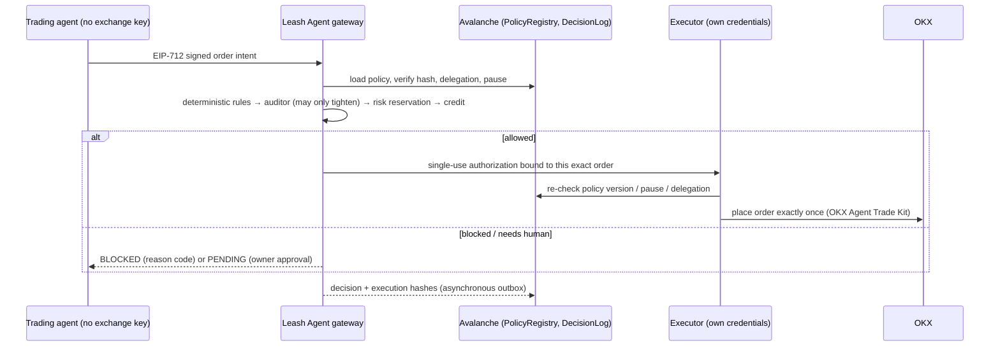
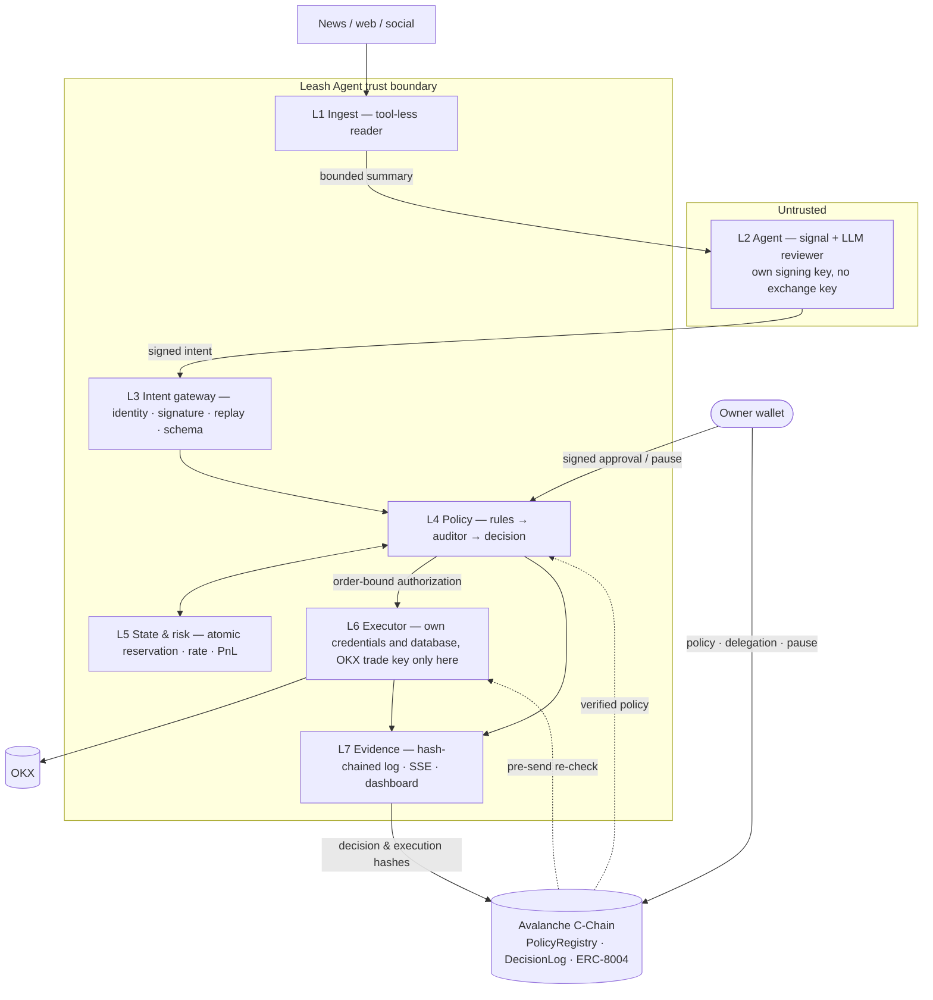

# Leash Agent

**A security gateway that keeps AI trading agents on a leash.**

Autonomous trading agents are easy to steer: a poisoned news article or a prompt injection is enough to make an LLM
place an order its owner never wanted. Leash Agent separates *reasoning* from *authority*. The agent never holds an
exchange key — it can only propose signed order intents. Leash Agent checks every intent against the owner's
policy on Avalanche, executes only what is allowed through a dedicated executor on OKX, and anchors every decision
on-chain as evidence.

> **Claim.** On an account managed by Leash Agent, an order that violates the verified owner policy and increases
> risk does not reach the exchange through Leash Agent — even if the agent's LLM is prompt-injected or fully
> compromised.
>
> *Conditions:* no other copy of the OKX trade key exists, all write paths go through the gateway, and the software
> behaves as specified. See [Limitations](#limitations).

---

## Contents

- [How it works](#how-it-works)
- [Architecture](#architecture)
- [Security model](#security-model)
- [Live deployment (Avalanche Fuji)](#live-deployment-avalanche-fuji)
- [Getting started](#getting-started)
- [Configuration](#configuration)
- [HTTP API](#http-api)
- [Testing](#testing)
- [Deployment](#deployment)
- [Repository layout](#repository-layout)
- [Roadmap](#roadmap)
- [Limitations](#limitations)

---

## How it works



1. **Agent proposes.** The agent observes the market (public data, no key), computes a deterministic signal, asks an
   LLM reviewer whether to act, and signs an `OrderIntent` with its own key. External text reaches it only as a
   bounded summary produced by an isolated, tool-less reader.
2. **Gateway decides.** Leash Agent authenticates the agent, normalizes the order, derives risk fields itself (never
   trusting the agent), applies the owner's on-chain policy, and asks an independent auditor (Jev or another model;
   a rule-based fallback in local demos) — which can only block or escalate, never approve.
3. **Executor acts.** Only an order with a valid, single-use, order-bound authorization reaches OKX, and only once.
4. **Evidence is anchored.** Every decision and execution event is hash-chained locally and written to Avalanche —
   evidence of what Leash Agent decided and what the executor reported, not proof of an exchange fill.
5. **Owner stays in control.** Policy changes, human approvals and the emergency pause require the owner's wallet
   signature; the dashboard shows every decision live.

---

## Architecture



| Layer | Responsibility |
|---|---|
| **L1 Ingest** | Fetches external content as untrusted, turns it into a fixed-schema summary with a tool-less model, flags embedded instructions, keeps a read record. Raw content never reaches the agent. |
| **L2 Agent** | Autonomous loop: observe → signal → LLM review → signed intent. Holds no exchange credentials (refuses to start if any are present) and can only reach allow-listed hosts. |
| **L3 Intent gateway** | Verifies agent identity and delegation, EIP-712 signature, timestamp window, single-use nonce, request idempotency, tool allowlist and strict schema; normalizes the order to lot/tick size. |
| **L4 Policy** | Loads the owner policy and verifies its hash against the chain; derives `riskIncreasing` / notional itself; applies deterministic rules (instrument, tool, per-order and open-notional limits, rate, daily loss, price deviation, pause, data freshness); consults the auditor; signs the authorization. |
| **L5 State & risk** | Persistent SQLite state, atomic risk reservation in one transaction, rate counter, daily PnL, reconciliation of uncertain orders. |
| **L6 Executor** | Own credentials and database; the OKX trade key is handed only to its Agent Trade Kit subprocess. Verifies the authorization (signer, expiry, nonce, order hash, account, policy version, and in TEE mode the signer's attestation), re-checks the policy on-chain, writes a write-ahead record, calls OKX exactly once, never blindly retries. Runs in-process in the bundled gateways; it can run on its own host and attest the gateway remotely. |
| **L7 Evidence** | Append-only, hash-chained audit log; durable outbox to `DecisionLog`; masked SSE stream for the dashboard. |
| **Chain** | `PolicyRegistry` (policy hash, version, delegation, pause) and `DecisionLog` (decision and execution hashes) on Avalanche; ERC-8004 identities for discovery. |

**Decision order** for a risk-increasing order: authenticate → verify policy → fresh market/risk state → pause gate →
reserve service credit → deterministic rules → auditor / human threshold → re-check state → atomic risk reservation →
finalize credit once → issue one authorization → executor re-check → one exchange write → reconcile.

The full specification — data types, state machine, reason codes, storage schema and invariants — is in
[`SONPLAN.md`](SONPLAN.md).

---

## Security model

**Guarantees** (each covered by tests, see [Testing](#testing)):

- The agent process holds **no exchange key**; only the executor can write to OKX, and the trade key is passed
  only to the executor's Agent Trade Kit subprocess.
- Fields the agent could lie about (`riskIncreasing`, notional, balances, "protective") are **derived by the
  gateway**, never taken from the agent.
- Forbidden tools, unknown tools and extra fields are rejected before policy evaluation.
- The auditor model can **only block or escalate** — it can never turn a rule `BLOCK` into an `ALLOW`. If it is
  unreachable, the order waits for a human.
- A `PENDING` order becomes executable only with the **owner's signature** and a full re-run of the rules on fresh
  state; an approval never bypasses a changed limit, pause or price.
- Authorizations are **single-use and bound** to one normalized order, account, policy version and gateway instance,
  and expire quickly (30 s in the demo policy).
- **One request ⇒ at most one exchange write.** Timeouts become `UNKNOWN` and are reconciled, never resent.
- Risk reservation and limit check are **atomic**: parallel requests cannot exceed the open-notional limit.
- A policy is valid only if its hash matches the on-chain record; missing or stale policy, risk or market data stops
  risk-increasing orders (**fail-closed**).
- The audit log is append-only and hash-chained; a broken chain is detected. A delayed chain write never changes
  an execution decision.
- **Payment is not authorization** (x402 buys service credits only) and **identity is not authorization**
  (ERC-8004 is for discovery; authority comes from the owner's EIP-712 delegation).
- **TEE mode** (optional): the executor accepts an authorization only if its signer holds a fresh, accepted
  attestation from an allow-listed build. See [TEE Lite](docs/TEE.md).

**Not claimed:** eliminating market losses, catching every attack, proving completeness of all decisions on-chain,
or cryptographically verifying OKX fills.

---

## Live deployment (Avalanche Fuji)

Contracts are deployed on the Avalanche Fuji testnet with verified source code.

| Component | Address / proof |
|---|---|
| `PolicyRegistry` — owner policy, delegation, emergency pause | [`0x9d0f1e30aF144074f4A8bE191fd5DB4F1F51f68F`](https://testnet.snowtrace.io/address/0x9d0f1e30aF144074f4A8bE191fd5DB4F1F51f68F) |
| `DecisionLog` — hashes of decisions and execution events | [`0xdC10FdDF2B58aeB674EBE4899A2a5C3276070d96`](https://testnet.snowtrace.io/address/0xdC10FdDF2B58aeB674EBE4899A2a5C3276070d96) |
| ERC-8004 identities (official registry) | Leash Agent **#266**, demo trading agent **#267** on [`0x8004A818BFB912233c491871b3d84c89A494BD9e`](https://testnet.snowtrace.io/address/0x8004A818BFB912233c491871b3d84c89A494BD9e) |
| Example on-chain decision + execution | [`0xf0fc…bd71`](https://testnet.snowtrace.io/tx/0xf0fcd77d9f9c66779ef79819fae435df82750caaf8d8150e9ea2194bb290bd71) |
| Measured finality (public RPC, median) | emergency pause ~4.3 s · decision log ~3.1 s |

The gateway has also been run end to end against a real OKX account through the
[OKX Agent Trade Kit](https://github.com/okx/agent-trade-kit), using limit orders. What each claim rests on, and what
we deliberately do not claim yet: [`docs/CLAIMS.md`](docs/CLAIMS.md).

---

## Getting started

### Requirements

- **Node.js ≥ 22.13** (24 recommended; the gateway uses the built-in `node:sqlite`)
- **Foundry** (`forge`, `anvil`) for contract tests and the local-chain parts of the demo
- For live runs: a funded Fuji key for the `DecisionLog` logger; optionally OKX **demo** API keys

### Install and test

```bash
git clone https://github.com/ulukansarikaya/leashagent.git
cd leashagent
npm install
npm test                 # all TypeScript tests (local-chain tests run when anvil is installed)
npm run test:contracts   # Solidity tests
```

### Run the demo (offline)

```bash
npm run demo:attack              # end-to-end story in the terminal
npm run demo:attack -- --serve   # same, and keep the dashboard running at http://127.0.0.1:8787
```

The demo needs no keys and moves no funds. With Foundry installed it starts a throwaway local chain with the real
`DecisionLog` contract and an ERC-8004 registry. It walks through:

1. **Discovery** — the agent finds Leash Agent through its ERC-8004 registration.
2. **x402 credits** — an order without credit is rejected (`REJECTED_PAYMENT`); the agent pays and gets 5 credits;
   a non-delegated payer and a replayed payment are refused.
3. **Unprotected agent** — reading a poisoned article, the agent would send a 325,000 USDT order straight to the
   exchange.
4. **Protected agent** — the same article passes through the ingest layer; the agent only sees a flagged summary.
5. **Compromised agent** — the attacker's valid, signed order is blocked by the owner's policy (`BLOCKED 103`,
   per-order limit); an injection-steered order is blocked by the auditor; a non-allowed instrument is blocked.
6. **Human approval** — an order above the approval threshold waits for the owner; approval re-runs all checks, and
   a price move while waiting blocks it.
7. **Evidence** — every decision and execution is written to `DecisionLog`.

### Live security demo (real gateway + executor)

```bash
npm run demo:live                    # the whole security story, with an OKX write counter per step
npm run demo:live -- --serve --pace 4   # same, slowed down, with the dashboard open for a presentation
```

No credit → 402 · x402 purchase · normal trade → ALLOW · oversize signed trade → `BLOCK 103` · prompt-injected trade →
auditor `BLOCK 201` · owner approval after a price move → `BLOCK 107` (approval is not a bypass) · on-chain pause while
an authorization is in flight → `REVOKED` at the executor · replay / forged intent → `REJECTED_AUTH`. Every rejected
step shows **0 exchange writes**.

### Run the agent (one command)

```bash
npm run agent:live
```

Starts the real gateway and executor (live OKX public prices, x402 credits, simulated exchange) and the agent in its
own process with an allow-listed environment — it never sees an exchange key. The agent reads news through the ingest
layer, computes its signal, reviews it (Claude if `AGENT_LLM_API_KEY` is set), signs the intent, buys credits on 402
and submits again. To point the agent at another gateway:

```bash
LEASH_URL=https://<gateway> AGENT_AUTH_KEY=0x… LEASH_POLICY_ID=0x… AGENT_ID=eip155:43113:0x…:<id> npm run agent
```

### Run against the Fuji deployment

```bash
cp .env.example .env     # fill in LOGGER_PRIVATE_KEY and DEPLOYER_ADDRESS
npm run gateway:fuji     # gateway + executor + dashboard on the live Fuji policy (OKX faked by default)
npm run e2e:fuji         # live flow: 402 → x402 purchase → allowed + blocked orders → on-chain evidence
```

Set `OKX_MODE=atk` with OKX demo keys to trade on an OKX demo account instead of the simulated exchange.

---

## Configuration

Secrets are read from the environment (or `.env`, which is git-ignored) and never appear in events or logs.
See [`.env.example`](.env.example).

| Variable | Used by | Purpose |
|---|---|---|
| `CHAIN_RPC_URL`, `CHAIN_ID` | gateway | Avalanche RPC (Fuji: 43113) |
| `POLICY_REGISTRY_ADDRESS`, `DECISION_LOG_ADDRESS` | gateway | Contract addresses |
| `LOGGER_PRIVATE_KEY` | gateway | Key allowed to write to `DecisionLog` |
| `DEPLOYER_ADDRESS` / `X402_PAY_TO` | gateway | x402 payment recipient |
| `X402_MODE` | gateway | `payai` for the PayAI facilitator; mock settlement otherwise |
| `GUARD_SIGNING_KEY` | gateway | Authorization signing key (generated per start if unset) |
| `OKX_MODE`, `OKX_PROFILE`, `OKX_SITE` | gateway, executor | `atk` for real OKX through the Agent Trade Kit; `demo` or `live` profile |
| `OKX_READ_KEY/SECRET/PASSPHRASE` | gateway | Read-only OKX key (risk data, order ownership) |
| `OKX_TRADE_KEY/SECRET/PASSPHRASE` | **executor only** | Trade key, no withdrawal permission |
| `MARKET_BUY_ENABLED` | gateway | Market buys stay disabled until the OKX unit semantics are verified |
| `TEE_MODE`, `TEE_MAX_AGE_SEC`, `TEE_ALLOWED_MEASUREMENTS` | gateway, executor | TEE Lite: `off` (default), `simulated` or `tdx` (Intel TDX on Phala Cloud) — see [`docs/TEE.md`](docs/TEE.md) |
| `AGENT_AUTH_KEY`, `LEASH_URL`, `LEASH_POLICY_ID`, `AGENT_ID` | agent | Agent signing key and gateway endpoint |
| `AGENT_LLM_API_KEY` | agent | Optional LLM reviewer (Anthropic API); rule-based reviewer otherwise |
| `READER_MODEL_API_KEY`, `AUDITOR_API_KEY`, `AUDITOR_PROVIDER`, `JEV_ENDPOINT` | simulated gateway | Model-backed reader and auditor (`llm`, `jev` or `heuristic`). The Fuji and local gateways currently use the rule-based reader and auditor — see [Roadmap](#roadmap). |

---

## HTTP API

| Method and path | Caller | Purpose |
|---|---|---|
| `POST /v1/intents` | agent | Submit a signed order intent → status and reason code |
| `GET /v1/intents/:requestId` | agent, dashboard | Status, normalized order and decision summary |
| `POST /v1/reads` | agent | Signed read request → bounded `ReadSummary` |
| `POST /v1/credits` | agent | x402 purchase of service credits (`X-PAYMENT` header) |
| `POST /v1/approvals` | dashboard (owner-signed) | Approve or reject a pending order |
| `POST /v1/pause` | dashboard (owner-signed) | Emergency pause / resume |
| `GET /v1/policy/:policyId` | dashboard | Policy, hash and on-chain verification status |
| `GET /v1/events` | dashboard | Server-sent events: masked, hash-chained audit stream |
| `GET /v1/health` | anyone | Component status, chain-evidence counters and TEE state |
| `GET /v1/attestation` | anyone | Latest attestation evidence for the authorization signer (TEE mode) |
| `POST /v1/attestation` | verifier | Answer a challenge `{ nonce }` with fresh evidence (TEE mode) |

Every rejection carries a reason code: `000–099` identity, schema, policy or payment (`004` = no service credit);
`100–199` deterministic rules; `200–299` auditor blocks; `300–399` routed to a human; `400–499` execution;
`500–599` infrastructure.

---

## Testing

```bash
npm run gate               # everything below + live checks; reports live checks without credentials as SKIPPED
npm run typecheck          # TypeScript across all packages
npm test                   # 400+ tests: unit, integration, invariants, attacks, acceptance, TEE
npm run test:contracts     # 35 Solidity tests (Foundry)
npm run test:invariants    # security invariants and attack scenarios over HTTP
npm run test:acceptance    # gateway acceptance suite (simulated gateway by default)
npm run e2e:okx-demo       # limit buy/sell, cancel, duplicate clOrdId, lost reply → UNKNOWN → reconcile
                           #   (OKX_MODE=atk + demo keys for the real exchange; dry run otherwise)
npm run e2e:x402           # 402 → pay → 5 credits → ALLOW uses one, BLOCK/PENDING none, replay mints nothing
                           #   (X402_MODE=payai + a Fuji USDC wallet for real settlement; mock otherwise)
npm run e2e:fuji           # live Fuji PolicyRegistry + DecisionLog (needs .env)
```

The acceptance suite talks to the gateway only over HTTP, so the same tests run against the real gateway:

```bash
npm run gateway:dev        # local gateway + executor; prints the variables for the next command
LEASH_GATEWAY_URL=… LEASH_AGENT_KEY=… LEASH_OWNER_KEY=… LEASH_POLICY_ID=… LEASH_AGENT_ID=… \
LEASH_TEST_ESCALATE_SZ=… npm run test:acceptance
```

Covered scenarios include impersonation, intent and reason tampering, nonce replay, idempotent retries, forbidden
tools, extra fields, stale timestamps, limit violations, missing credit, emergency pause, owner approval with fresh
re-evaluation, prompt injection, the policy-identity binding, the audit hash chain and TEE attestation (INV-22,
including a real Intel TDX quote verified offline). CI ([`.github/workflows/ci.yml`](.github/workflows/ci.yml))
builds and tests the contracts, checks that the generated ABI module is up to date, type-checks and runs the full
test suite; [`image.yml`](.github/workflows/image.yml) publishes the gateway image to GitHub Container Registry on
demand.

---

## Deployment

A public demo (Fuji testnet, simulated or OKX demo exchange) runs on any Linux server with Docker:

```bash
cp .env.example .env && chmod 600 .env   # LOGGER_PRIVATE_KEY, DEPLOYER_ADDRESS, SITE_ADDRESS
docker compose up -d --build             # gateway + dashboard behind Caddy (automatic HTTPS for a domain)
```

Step-by-step guide: [`docs/DEPLOY.md`](docs/DEPLOY.md).

**With a TEE (Intel TDX on Phala Cloud).** Publish the image (`image` workflow), pin its digest in
[`deploy/phala/docker-compose.yml`](deploy/phala/docker-compose.yml), create a `tdx.small` CVM with that file and set
the secrets as encrypted environment variables. The gateway then generates its signing key inside the TD and serves
verifiable evidence at `/v1/attestation`. Full steps: [`docs/TEE.md`](docs/TEE.md).

---

## Repository layout

```
packages/
  shared/        Types, canonical JSON, EIP-712 types and signing, policy/agent identity, schemas, decimals
  ingest/        L1 — isolated reader for external content
  agent/         L2 — trading agent loop and gateway client
  gateway/       L3–L5, L7 — intent gate, policy engine, risk store, approvals, pause, audit log, HTTP + SSE
  executor/      L6 — authorization verification, single write, reconciliation
  atk/           OKX Agent Trade Kit adapter (MCP and CLI transports) and public market data
  auditor/       Auditor adapters: LLM, Jev, rule-based
  attestation/   TEE Lite: attested-signer verifier, Intel TDX (dstack) adapter, simulated platform
  llm/           Minimal stateless LLM client
  chain/         Solidity contracts (Foundry), policy client, durable chain outbox, deployments
  payments/      x402: credit ledger, purchase flow, facilitator and mock settlement
  identity/      ERC-8004 registration cards, publishing and discovery
  dashboard/     Static web dashboard (HTTP + SSE only)
  mocks/         Test doubles for chain, OKX, risk and payments (tests and local runs only)
  mock-gateway/  Simulated gateway for the offline demo and tests (never used in production paths)
scripts/         Demo, local/Fuji gateways, deployment and live verification scripts
tests/           Acceptance, attack, invariant and integration suites
deploy/          Caddy reverse-proxy config; Phala Cloud (Intel TDX) compose file
docs/            Deployment guide, TEE design, OKX integration notes, team handoffs
.github/         CI and image-publishing workflows
SONPLAN.md       Full architecture specification
```

---

## Roadmap

**Done**

- [x] Seven-layer enforcement path with fail-closed defaults and a single, idempotent exchange write
- [x] Owner policy, delegation and emergency pause on Avalanche; decision evidence in `DecisionLog`
- [x] Isolated ingest, autonomous agent loop, auditor adapter and prompt-injection defenses
- [x] x402 service credits and ERC-8004 identities on Fuji
- [x] Live dashboard with owner-signed approvals and emergency pause
- [x] End-to-end run against a real OKX account (limit orders)
- [x] Docker deployment for a public demo
- [x] **TEE Lite** — attested authorization signer: challenge, quote verification, measurement allow-list, signer
      binding, expiry, executor enforcement (INV-22); Intel TDX adapter for Phala Cloud (DCAP + RTMR3 replay),
      validated against a real TDX quote

**Next**

- [ ] **Hosted public demo** — run the gateway and dashboard on a public URL and publish that endpoint in the ERC-8004 card
- [ ] **Market orders** — verify OKX market-order size semantics on a demo account, then enable market buys
- [ ] **Model-backed review** — run the agent reviewer, reader and auditor on a production LLM; integrate the Jev auditor
- [ ] **Real x402 settlement** — paid settlement with Fuji USDC through the PayAI facilitator
- [ ] **TEE on hardware** — activate `TEE_MODE=tdx` on a Phala Cloud CVM; adapter, compose file and image
      workflow are ready (`deploy/phala/`, [`docs/TEE.md`](docs/TEE.md))
- [ ] **Operational hardening** — request rate limiting, monitoring and alerting, key rotation

**Later**

- [ ] **Separate executor host** — run the executor (with the OKX trade key) on its own machine, attesting the
      gateway remotely before accepting any authorization
- [ ] **Full TEE enforcement** — bring the OKX trade credential inside the attested boundary, with key rotation and revocation
- [ ] **Horizontal scaling** — risk reservations across multiple workers
- [ ] **Mainnet** — Avalanche C-Chain and live OKX accounts after an independent security review

---

## Limitations

- A bad trade **within** the owner's limits can still pass: Leash Agent limits loss, it does not eliminate it.
- The daily-loss limit is not an absolute ceiling (gaps, latency, slippage).
- The auditor model can be wrong and can itself be manipulated; it is an extra signal, not a security boundary.
- The gateway process and its signing key are trusted until TEE mode runs on real hardware (`tdx`); the simulated
  platform adds no security. Even with TDX, the OKX trade key stays outside the TD (TEE Lite).
- Ownership of the OKX account by the owner wallet is operator configuration, not a cryptographic proof.
- Risk reservations are atomic within a single worker.
- Spot trading only; market buys are disabled until the exchange semantics are verified.

---

No license has been chosen yet; all rights are reserved by the authors until one is added.
