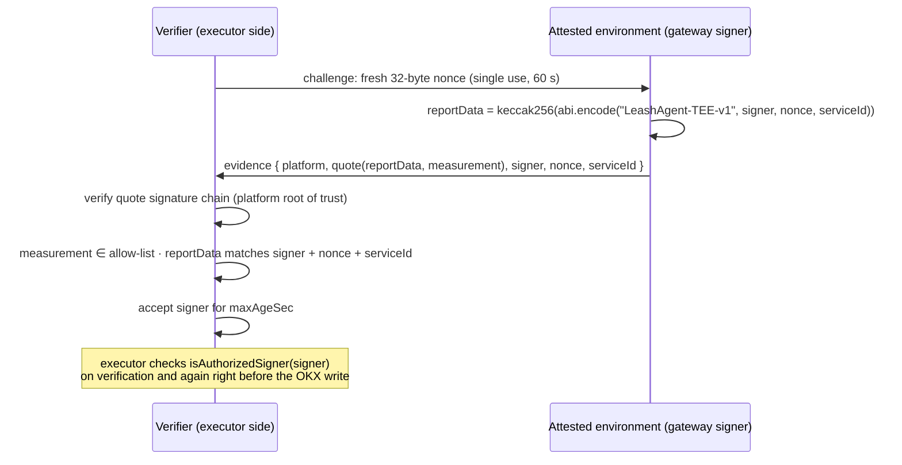

# TEE Lite — attested authorization signer

Status: **protocol, enforcement and the Intel TDX (Phala Cloud / dstack) adapter are implemented and tested;
not yet running on a live TD.** The TDX verifier was checked against a real Phala quote (DCAP `UpToDate`,
RTMR3 replay and compose-hash match).
Specification: [`SONPLAN.md`](../SONPLAN.md) §21.4, invariant INV-22.

## What it protects

Without TEE, the gateway process and its authorization signing key are trusted: whoever controls the gateway host
can sign an authorization for any order. TEE Lite narrows that trust:

- The authorization signing key is generated **inside** an attested environment and never leaves it.
- The executor (L6) accepts an authorization only if its signer holds a **currently accepted, fresh attestation**
  from an allow-listed software build (INV-22). Otherwise the order is rejected with reason `401` before any
  exchange call.

What it does **not** protect: the OKX trade key still lives in the executor, outside the TEE, so the executor host is
still trusted not to bypass Leash Agent. TEE Lite must therefore never be described as "all execution is protected
by a TEE". It also does not prove the policy code is bug-free, the auditor is right, market data is true, OKX fills
are accurate or chain logging is complete.

## Protocol

The gateway re-attests every `maxAgeSec / 3`. If re-attestation keeps failing, acceptance lapses and the executor
stops accepting that signer (fail closed). The gateway refuses to start if the first attestation is rejected.

Rejections: `malformed`, `unknown_nonce`, `stale_challenge`, `wrong_service`, `unsupported_platform`,
`quote_invalid`, `measurement_not_allowed`, `report_data_mismatch`, `stale_quote`.

## Code

| Piece | Location |
|---|---|
| Evidence type, report-data binding, schema | `packages/shared/src/attestation.ts` |
| `AttestationVerifier` interface (§21.6) | `packages/shared/src/types.ts` |
| Verifier: challenges, quote check, allow-list, binding, expiry | `packages/attestation/src/registry.ts` (`AttestedSignerRegistry`) |
| Platform ports | `packages/attestation/src/ports.ts` (`QuoteVerifier`, `AttestationProvider`) |
| Simulated platform | `packages/attestation/src/simulated.ts` |
| Intel TDX on dstack: provider, DCAP verifier, RTMR3 replay | `packages/attestation/src/tdx.ts` |
| Remote verifier transport (executor on another host) | `packages/attestation/src/remote.ts` |
| Re-attestation loop | `packages/attestation/src/keep-attested.ts` |
| Executor enforcement | `packages/executor/src/executor.ts` (`requireAttestedSigner`) |
| Gateway wiring, `GET /v1/attestation`, `/v1/health → tee` | `scripts/lib/tee.ts`, `packages/gateway/src/http.ts` |
| Tests (INV-22) | `packages/attestation/test`, `packages/executor/test` ("TEE mode") |

## Configuration

| Variable | Default | Meaning |
|---|---|---|
| `TEE_MODE` | `off` | `off`, `simulated` or `tdx` |
| `TEE_SERVICE_ID` | `leashagent-gateway` | Expected environment identity bound into every quote |
| `TEE_MAX_AGE_SEC` | `300` | How long one accepted attestation authorizes the signer |
| `TEE_ALLOWED_MEASUREMENTS` | simulated build (required for `tdx`) | Comma-separated allow-list of software measurements |
| `TEE_TDX_ACCEPTED_TCB` | `UpToDate,SWHardeningNeeded` | Intel TCB statuses accepted for TDX quotes |
| `TEE_SIM_LABEL` | `leashagent-gateway` | Build label for the simulated measurement |

`GET /v1/attestation` returns the latest evidence and the verifier status so anyone can check which signer is
attested. `POST /v1/attestation` with `{ "nonce": "0x…32 bytes" }` answers a verifier's challenge with fresh
evidence — this is how an executor on another host attests the gateway (`RemoteAttestationProvider`). The
dashboard shows the TEE state in the policy panel.

## The simulated platform is not a TEE

`TEE_MODE=simulated` runs the complete protocol with a software "root of trust" that lives in the same process.
It proves the wiring — challenges, binding, allow-list, expiry and executor enforcement — and lets the same code run
on any machine, including a plain VPS. Anyone with access to the process can forge its quotes, so it adds **no**
security. The dashboard and `/v1/health` label it as simulated.

## Intel TDX on Phala Cloud (dstack)

**Measurement.** A dstack TD extends RTMR3 with runtime events, including per-instance ones (`app-id`,
`instance-id`), so RTMR3 itself cannot be pinned. The verifier instead:

1. verifies the quote with Intel DCAP up to Intel's production root CA, with fresh collateral (Phala PCCS, cached
   for an hour) and an accepted TCB status; debug TDs are refused;
2. recomputes every RTMR3 event digest as `sha384(event_type u32 LE ‖ ":" ‖ name ‖ ":" ‖ payload)` — never trusting
   the log's own `digest` field, which dstack omits anyway — replays from 48 zero bytes and requires the quote's
   RTMR3;
3. takes the single `compose-hash` event from that verified log;
4. allow-lists `keccak256(MRTD ‖ RTMR0 ‖ RTMR1 ‖ RTMR2 ‖ compose-hash)` — firmware, OS image and this app's compose
   file, which pins the image digest;
5. requires `REPORTDATA = reportData(signer, nonce, serviceId) ‖ 32 zero bytes`.

**Deploy on Phala Cloud** (CVM `tdx.small` is enough):

1. Publish the image: run the `image` workflow (GitHub → Actions → image → Run workflow). Its summary prints
   `ghcr.io/ulukansarikaya/leashagent@sha256:…`. Make the package public, or give Phala registry credentials.
2. Put that digest into [`deploy/phala/docker-compose.yml`](../deploy/phala/docker-compose.yml).
3. Create the CVM with that compose file. Set encrypted environment variables: `LOGGER_PRIVATE_KEY`,
   `DEPLOYER_ADDRESS` (and OKX demo keys if used). **Do not set `GUARD_SIGNING_KEY`** — in `tdx` mode the gateway
   refuses it, because the signing key must be generated inside the TD.
4. First boot without `TEE_ALLOWED_MEASUREMENTS`: the gateway refuses to start and logs
   `This deployment measures 0x…`. Before trusting it, check that the compose-hash Phala shows for the app equals
   the SHA-256 of the app-compose you submitted.
5. Set `TEE_ALLOWED_MEASUREMENTS` to that value and restart. `/v1/health` → `tee` shows the attested signer;
   `/v1/attestation` serves the evidence.

Any change to the compose file (for example a new image digest) changes the measurement, so the allow-list must be
updated with each release. Changing environment variable values does not.

**Honest scope.** In the bundled gateway the executor runs in the same process, inside the same TD, so the gateway
also checks its own attestation; the value an outside party gets is the public, verifiable evidence. The full TEE
Lite separation puts the executor (with the OKX trade key) on another host whose `AttestedSignerRegistry` challenges
the gateway through `RemoteAttestationProvider`.

## Adding another platform

Implement two interfaces from `packages/attestation/src/ports.ts` and register them in `scripts/lib/tee.ts`:

- `AttestationProvider.attest(nonce)` — runs inside the environment and requests a hardware report whose
  report-data field is `computeAttestationReportData(signer, nonce, serviceId)`.
- `QuoteVerifier.verify(quote)` — checks the report's signature chain up to the vendor root and returns the
  measurement and report data.

| Platform | Report data | Notes |
|---|---|---|
| AMD SEV-SNP (confidential VMs on major clouds) | 64-byte `REPORT_DATA` | Report signed by the VCEK; verify via AMD's certificate chain |
| AWS Nitro Enclaves | `user_data` / `nonce` in the attestation document | COSE-signed document chained to the AWS Nitro root; enclave has no network, so RPC and OKX traffic needs a vsock proxy |

Next milestone (SONPLAN §21.4 production target): move the OKX trade credential and the policy/risk enforcement path
inside the attested boundary, with key rotation and revocation.
