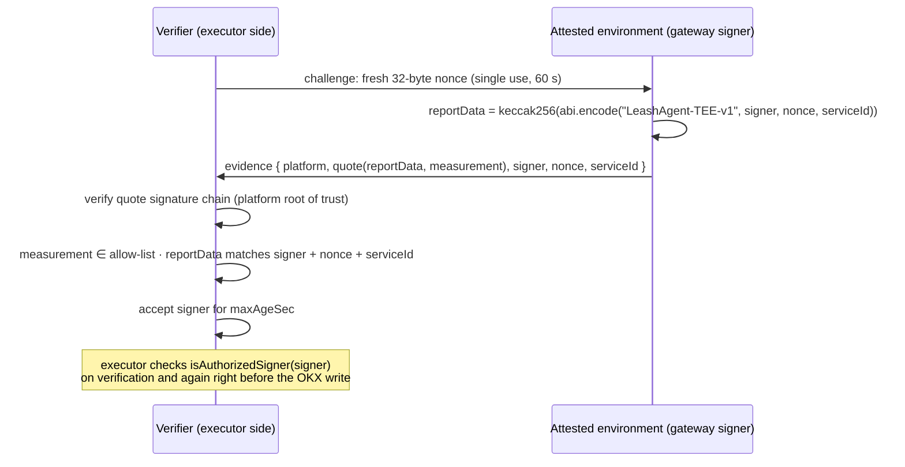

# TEE Lite — attested authorization signer

Status: **protocol and enforcement implemented; hardware platform adapter pending.**
Specification: [`SONPLAN.md`](../SONPLAN.md) §21.4, invariant INV-22.

## What it protects

Without TEE, the gateway process and its authorization signing key are trusted: whoever controls the gateway host
can sign an authorization for any order. TEE Lite narrows that trust:

- The authorization signing key is generated **inside** an attested environment and never leaves it.
- The executor (L6) accepts an authorization only if its signer holds a **currently accepted, fresh attestation**
  from an allow-listed software build (INV-22). Otherwise the order is rejected with reason `401` before any
  exchange call.

What it does **not** protect: the OKX trade key still lives in the executor, outside the TEE, so the executor host is
still trusted not to bypass Leash Agent. TEE Lite must therefore never be described as "all execution is protected
by a TEE". It also does not prove the policy code is bug-free, the auditor is right, market data is true, OKX fills
are accurate or chain logging is complete.

## Protocol

The gateway re-attests every `maxAgeSec / 3`. If re-attestation keeps failing, acceptance lapses and the executor
stops accepting that signer (fail closed). The gateway refuses to start if the first attestation is rejected.

Rejections: `malformed`, `unknown_nonce`, `stale_challenge`, `wrong_service`, `unsupported_platform`,
`quote_invalid`, `measurement_not_allowed`, `report_data_mismatch`, `stale_quote`.

## Code

| Piece | Location |
|---|---|
| Evidence type, report-data binding, schema | `packages/shared/src/attestation.ts` |
| `AttestationVerifier` interface (§21.6) | `packages/shared/src/types.ts` |
| Verifier: challenges, quote check, allow-list, binding, expiry | `packages/attestation/src/registry.ts` (`AttestedSignerRegistry`) |
| Platform ports | `packages/attestation/src/ports.ts` (`QuoteVerifier`, `AttestationProvider`) |
| Simulated platform | `packages/attestation/src/simulated.ts` |
| Re-attestation loop | `packages/attestation/src/keep-attested.ts` |
| Executor enforcement | `packages/executor/src/executor.ts` (`requireAttestedSigner`) |
| Gateway wiring, `GET /v1/attestation`, `/v1/health → tee` | `scripts/lib/tee.ts`, `packages/gateway/src/http.ts` |
| Tests (INV-22) | `packages/attestation/test`, `packages/executor/test` ("TEE mode") |

## Configuration

| Variable | Default | Meaning |
|---|---|---|
| `TEE_MODE` | `off` | `off` or `simulated`. Hardware platforms are rejected until their adapter exists. |
| `TEE_SERVICE_ID` | `leashagent-gateway` | Expected environment identity bound into every quote |
| `TEE_MAX_AGE_SEC` | `300` | How long one accepted attestation authorizes the signer |
| `TEE_ALLOWED_MEASUREMENTS` | simulated build | Comma-separated allow-list of software measurements |
| `TEE_SIM_LABEL` | `leashagent-gateway` | Build label for the simulated measurement |

`GET /v1/attestation` returns the latest evidence and the verifier status so anyone can check which signer is
attested. The dashboard shows the TEE state in the policy panel.

## The simulated platform is not a TEE

`TEE_MODE=simulated` runs the complete protocol with a software "root of trust" that lives in the same process.
It proves the wiring — challenges, binding, allow-list, expiry and executor enforcement — and lets the same code run
on any machine, including a plain VPS. Anyone with access to the process can forge its quotes, so it adds **no**
security. The dashboard and `/v1/health` label it as simulated.

## Adding a hardware platform

Implement two small interfaces from `packages/attestation/src/ports.ts` and register them in `scripts/lib/tee.ts`:

- `AttestationProvider.attest(nonce)` — runs inside the environment and requests a hardware report whose
  report-data field is `computeAttestationReportData(signer, nonce, serviceId)`.
- `QuoteVerifier.verify(quote)` — checks the report's signature chain up to the vendor root and returns the
  measurement and report data.

Candidate platforms (to be verified against current vendor documentation before choosing):

| Platform | Report data | Notes |
|---|---|---|
| Intel TDX (e.g. a TDX confidential VM) | 64-byte `REPORTDATA` | VM keeps normal networking; quote verified with Intel DCAP collateral |
| AMD SEV-SNP (confidential VMs on major clouds) | 64-byte `REPORT_DATA` | Report signed by the VCEK; verify via AMD's certificate chain |
| AWS Nitro Enclaves | `user_data` / `nonce` in the attestation document | COSE-signed document chained to the AWS Nitro root; enclave has no network, so RPC and OKX traffic needs a vsock proxy |

Requirements for any hardware mode:

1. The signing key must be **generated inside** the environment. Do not set `GUARD_SIGNING_KEY` in hardware mode.
2. The allow-list must contain the measurement of the exact build being deployed (reproducible image).
3. A plain VPS has no TEE hardware; hardware mode needs a confidential-computing instance.

Next milestone (SONPLAN §21.4 production target): move the OKX trade credential and the policy/risk enforcement path
inside the attested boundary, with key rotation and revocation.
